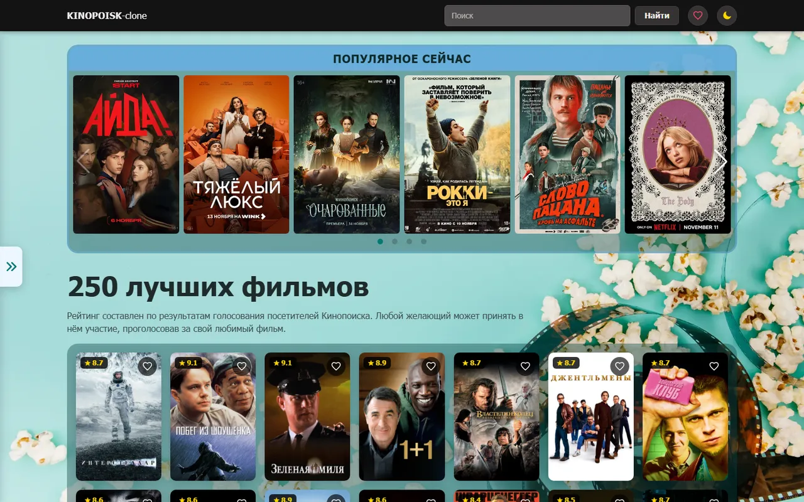
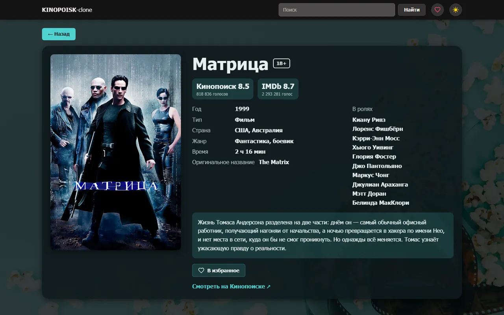
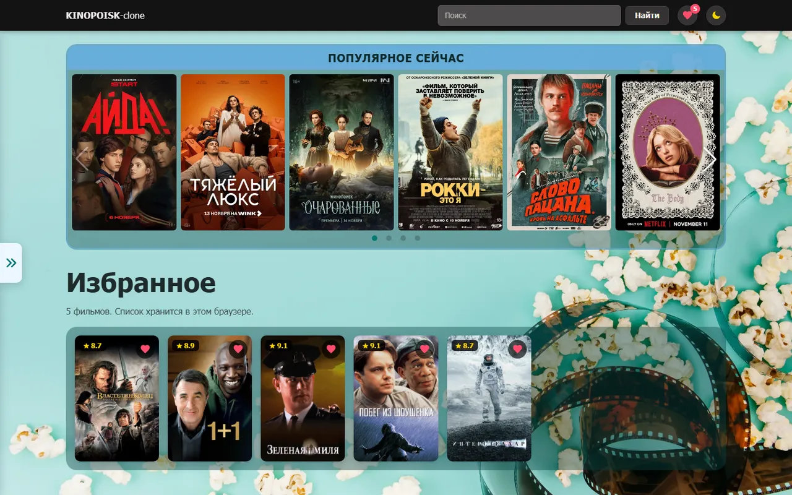
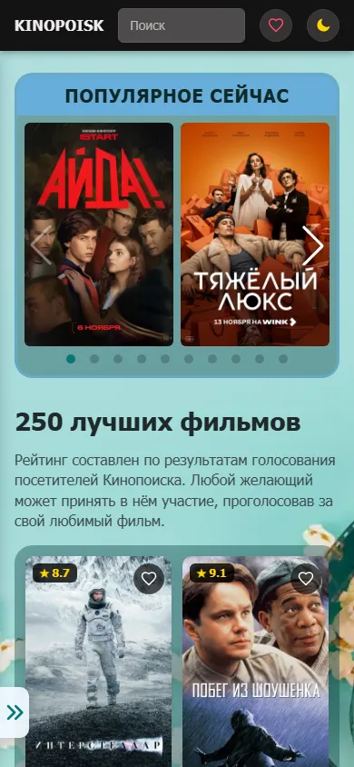
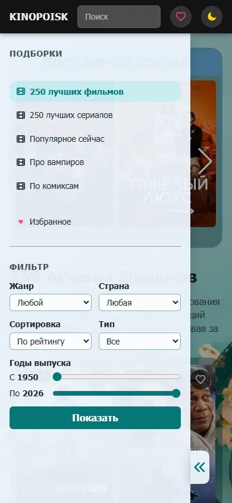
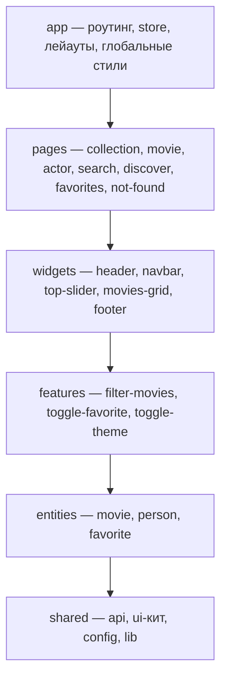

# Kinopoisk-clone

Каталог фильмов и сериалов на данных [Kinopoisk API Unofficial](https://kinopoiskapiunofficial.tech): подборки, поиск, фильтры, страницы фильмов и актёров, избранное, светлая и тёмная тема.

**Демо:** [kinopoisk-clone-orpin.vercel.app](https://kinopoisk-clone-orpin.vercel.app)

[](https://github.com/pollyBe/Kinopoisk-clone/actions/workflows/ci.yml)



| Страница фильма, тёмная тема                         | Избранное                                     |
| ---------------------------------------------------- | --------------------------------------------- |
|  |  |

<p>
  
  &nbsp;
  
</p>

## Возможности

- **Подборки**: 250 лучших фильмов и сериалов, популярное сейчас, тематические подборки.
- **Поиск** по названию и **фильтр** по жанру, стране, типу, годам и сортировке.
- **Страницы фильма и актёра**: рейтинги, описание, актёрский состав, факты, фильмография.
- **Избранное**: сохраняется в браузере и синхронизируется между вкладками.
- **Состояние в адресе**: номер страницы, запрос и фильтры живут в URL — ссылкой можно поделиться, кнопка «Назад» работает как ожидается.
- **Светлая и тёмная тема**: по умолчанию как в системе, выбор запоминается, без вспышки при загрузке.
- **Адаптивная вёрстка** от 360 px, скелетоны при загрузке, понятные ошибки с кнопкой «Повторить».
- **Доступность**: семантическая разметка, работа с клавиатуры, подписи для скринридеров.

## Стек

- **React 18**, **TypeScript** (strict), **Vite 6**, SCSS-модули
- **Redux Toolkit** + **RTK Query** — серверные данные и кэш; в Redux только тема и избранное
- **React Router 7**, **Swiper**
- **Vercel** — хостинг и serverless-функция-прокси к API
- **ESLint**, **Prettier**, **Steiger** (линтер Feature-Sliced Design), **GitHub Actions**

## Архитектура

Проект построен по [Feature-Sliced Design](https://feature-sliced.design/ru/). Слои импортируют только нижележащие, каждый слайс отдаёт наружу только свой `index.ts`; правила проверяет Steiger в CI.



```
src/
  app/        # точка входа, роуты, store, лейауты, токены и глобальные стили
  pages/      # страницы; компоненты, нужные одной странице, живут внутри неё
  widgets/    # крупные блоки интерфейса
  features/   # действия пользователя
  entities/   # бизнес-сущности: API-эндпоинты, модели, карточки
  shared/     # baseApi, UI-компоненты, конфиг, утилиты
api/          # serverless-функция Vercel: прокси к Kinopoisk API
```

### Несколько решений

- **Ключ API не попадает в браузер.** Клиент ходит в `/api/*`; на проде запрос проксирует функция `api/kinopoisk.ts` (ключ — в переменных окружения Vercel, разрешён только список нужных эндпоинтов, ответы кэшируются на CDN), локально — прокси Vite.
- **RTK Query** вместо десятка самописных слайсов: кэш, дедупликация, повтор запроса одной строкой.
- **Производительность**: страницы грузятся отдельными чанками, фон сжат с 5 МБ до 84 КБ, данные слайдера запрашиваются прямо из `<head>`, постеры первого экрана — с высоким приоритетом, в обход лишнего редиректа.
- **Дизайн-токены** в CSS-переменных; тёмная тема переопределяет только цветовые токены.

## Запуск локально

Нужны Node.js 20+ и ключ [kinopoiskapiunofficial.tech](https://kinopoiskapiunofficial.tech) (бесплатный, после регистрации).

```bash
git clone https://github.com/pollyBe/Kinopoisk-clone.git
cd Kinopoisk-clone
npm ci
cp .env.example .env   # и впишите свой ключ в KINOPOISK_API_KEY
npm run dev
```

> Не добавляйте ключу префикс `VITE_`: такие переменные попадают в клиентский бандл.

| Команда                | Что делает                                      |
| ---------------------- | ----------------------------------------------- |
| `npm run dev`          | dev-сервер с прокси к API                       |
| `npm run build`        | проверка типов (клиент и функция) и сборка      |
| `npm run preview`      | локальный просмотр сборки                       |
| `npm run lint`         | ESLint                                          |
| `npm run lint:fsd`     | Steiger — проверка правил Feature-Sliced Design |
| `npm run format`       | Prettier                                        |
| `npm run format:check` | проверка форматирования                         |

## Деплой

Репозиторий подключён к Vercel: каждый push в `main` выкатывается на прод, каждый PR получает превью. В настройках проекта нужна переменная окружения `KINOPOISK_API_KEY`. Маршрутизация SPA и прокси описаны в `vercel.json`.

## Данные

Данные и постеры — [Kinopoisk API Unofficial](https://kinopoiskapiunofficial.tech) и Кинопоиск; права на изображения принадлежат их владельцам. Проект некоммерческий и сделан для портфолио.

## Автор

Polina Belash — [GitHub](https://github.com/pollyBe)
